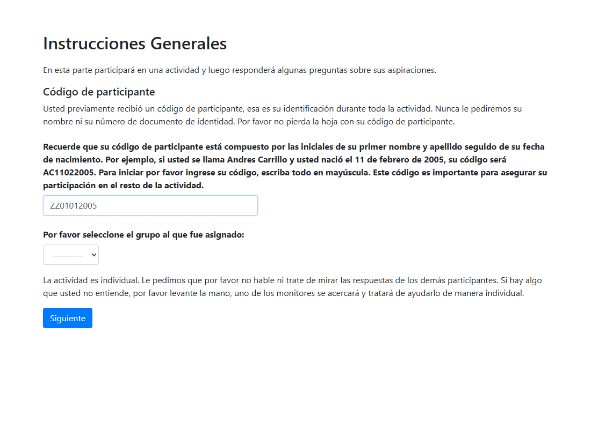
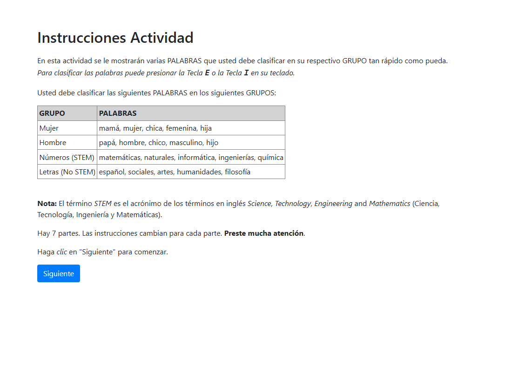
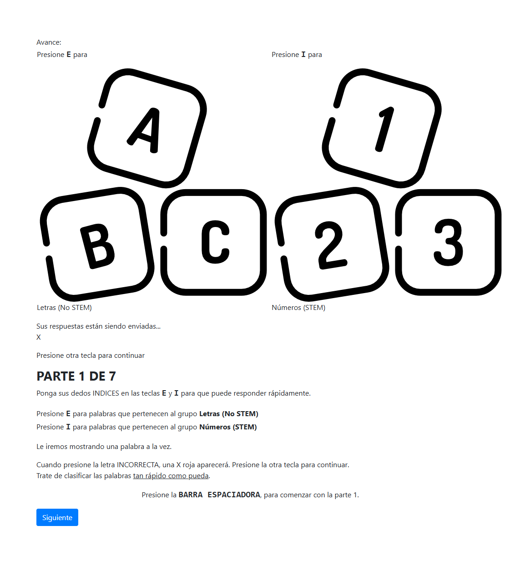
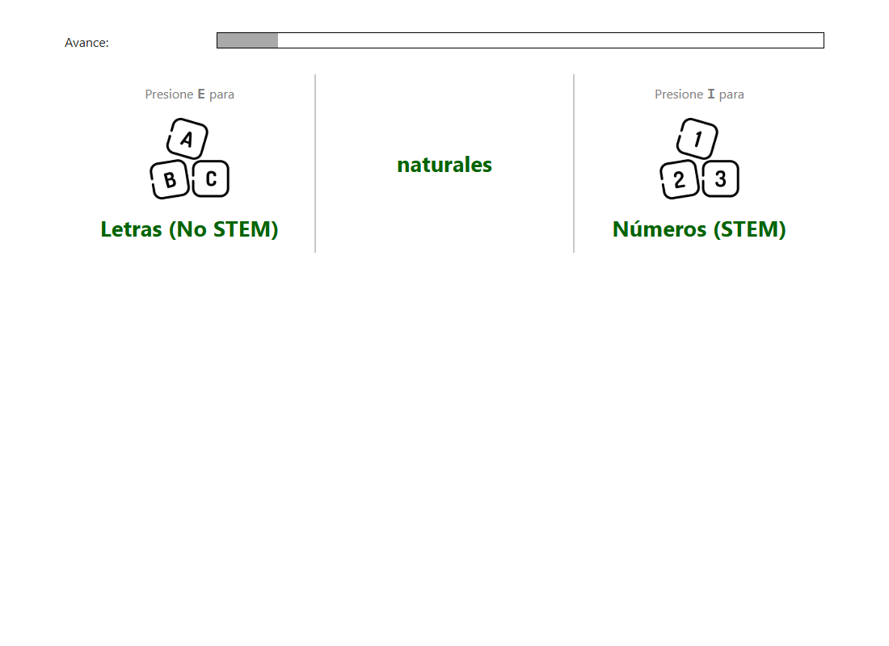
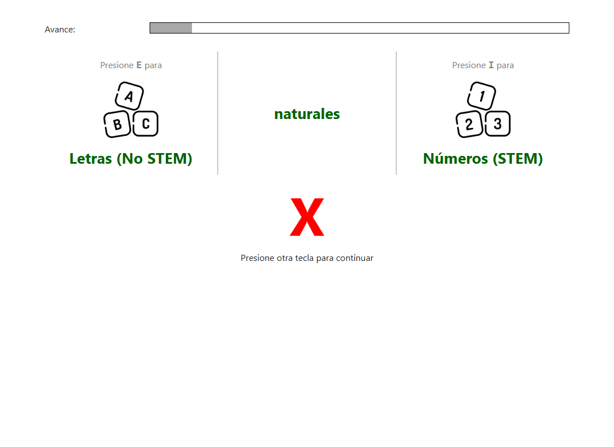
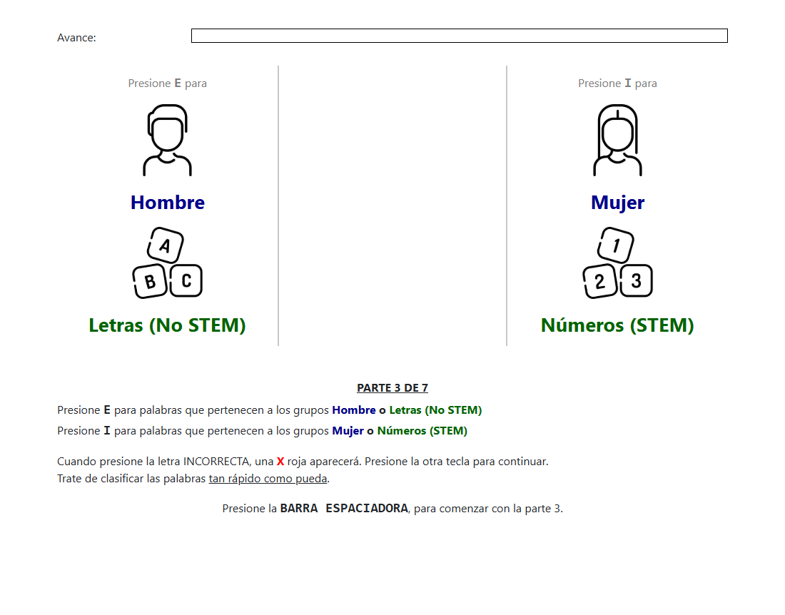
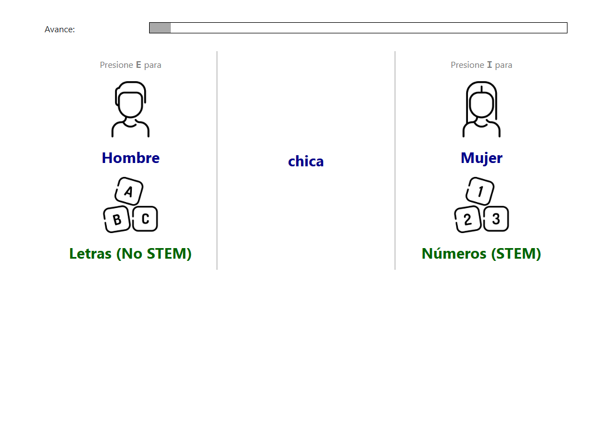

# Materiales para participantes

Lo que vieron los estudiantes en pantalla, en español, tal como está en las plantillas del repositorio. Las capturas se generaron en 2026 con `otree devserver` y datos de prueba (código `ZZ01012005`); no muestran a ningún participante real. El panel *Debug info* de oTree, que solo aparece en modo desarrollo, se ocultó en las capturas.

**Preregistro:** el experimento no fue preregistrado (así lo declara el working paper). No hay enlace de preregistro.

## 1. Bienvenida (`iat/templates/iat/welcome.html`, campos en `iat/models.py`)

El estudiante escribe su código de participante (iniciales del primer nombre y apellido + fecha de nacimiento, en mayúscula) y elige el grupo al que fue asignado con la ficha de color: **C** (control) o **T** (tratamiento). Se le recuerda que nunca se le pedirá su nombre ni su documento.

## 2. Instrucciones del IAT (`iat/templates/iat/Intro.html`)

## 3. Bloques del IAT (`iat/templates/iat/IATPage.html`)

Cada bloque empieza con sus instrucciones (qué tecla corresponde a cada grupo) y se inicia con la barra espaciadora. La palabra aparece en el centro; las imágenes y los nombres de los grupos quedan a los lados.

| | |
|---|---|
|  |  |
| Bloque 1: instrucciones | Bloque 1: un ensayo |
|  |  |
| Respuesta incorrecta: X roja; hay que presionar la otra tecla | Bloque 3 (combinado): instrucciones |
|  | |
| Bloque 3: un ensayo | |

Texto de las instrucciones de cada bloque (generado por la plantilla):

> PARTE *n* DE 7. [Solo en la parte 1: Ponga sus dedos INDICES en las teclas E y I para que puede responder rápidamente.] [Solo en la parte 5: CUIDADO, ¡Las categorías cambiaron de lado!] Presione E para palabras que pertenecen al grupo / a los grupos *…*. Presione I para palabras que pertenecen al grupo / a los grupos *…*. [Solo en la parte 1: Le iremos mostrando una palabra a la vez.] Cuando presione la letra INCORRECTA, una X roja aparecerá. Presione la otra tecla para continuar. Trate de clasificar las palabras tan rápido como pueda. Presione la BARRA ESPACIADORA, para comenzar con la parte *n*.

Al final del IAT: «Muchas gracias por participar en esta actividad» (`Outro.html`).

## 4. Encuesta (`survey/templates/survey/`, orden en `survey/pages.py`)

| # | Página | Contenido |
|---|---|---|
| 1 | `beliefs` | Creencias sobre los trabajos científicos y sobre igualdad de género en aptitudes (escala de acuerdo 1–5) |
| 2 | `efficacy` | Autoconcepto en ciencias y matemáticas e interés en trabajos científicos (escala 1–5) |
| 3 | `group` | Predicción: ¿hombres o mujeres de su salón tendrán mejor desempeño en cada prueba Saber 11? |
| 4 | `saber11` | Expectativas de puntaje propio en el examen Saber 11 (ICFES) |
| 5 | `explicit` | ¿Hombre o mujer? Estereotipo explícito por materia |
| 6 | `subjects` | Gusto y desempeño percibido por materia |
| 7 | `occupation` | Aspiraciones ocupacionales (texto libre, con tiempos) |
| 8 | `occupation2` | Aspiraciones ocupacionales: institución y tipo de educación |
| 9 | `careers` | Valoración de 20 carreras |
| 10 | `education` | Probabilidad esperada de entrar a la educación superior (deslizador) |
| 11 | `time` | Preferencias de riesgo y tiempo |
| 12 | `questions1` | Encuesta final: características personales |
| 13 | `questions2` | Encuesta final: hogar y padres |
| 14 | `thanks` | Agradecimiento y comentarios |

Las preguntas exactas, con sus opciones, están en [`diccionario_variables.md`](diccionario_variables.md) y en las plantillas HTML.
